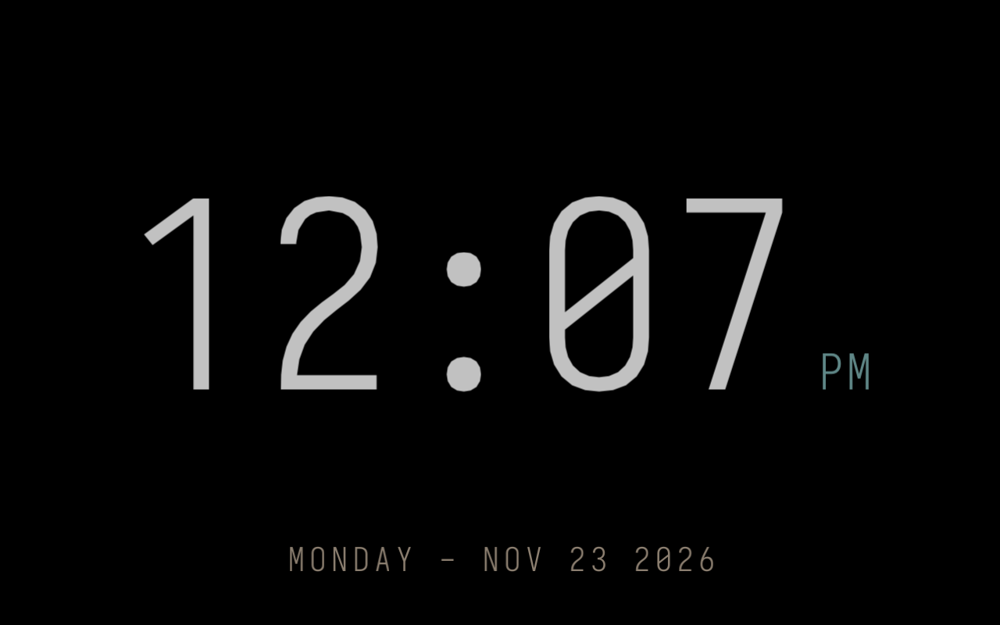
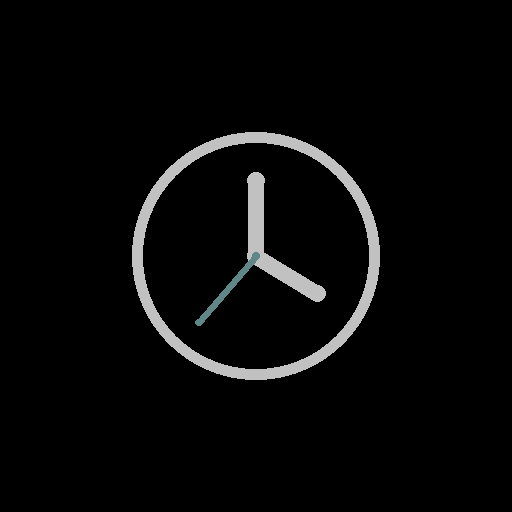

# clck

A minimal landscape clock for Android tablets, written in Rust as a native
`NativeActivity` app (no Java/Kotlin, no Gradle). Big 12-hour time, small
AM/PM accent, short date along the bottom, Iosevka Light everywhere.

Swipe left to flip to a matching minimal month calendar, which sits on the
right; swipe right to return. The clock is the default page. In the calendar,
tap the small `<` / `>` at the sides of the month title to step through months,
with the grid sliding sideways as it changes.





## Palette

Taken from `~/.config/kitty/theme.conf` (base16 Black Metal / Gorgoroth):

| role     | colour    |
| -------- | --------- |
| background | `#000000` |
| time     | `#c1c1c1` |
| AM/PM    | `#5f8787` |
| date     | `#8c7f70` |

## How it works

- `src/lib.rs` — `android_main` entry point, EGL/GLES3 setup, per-minute redraw
  loop, layout. Fullscreen, landscape-locked, and holds
  `FLAG_KEEP_SCREEN_ON` (re-applied on every window/resume event) so the device
  never sleeps while the clock is on screen.
- `src/text.rs` — glyph rasteriser (`fontdue`) into a 1024² single-channel
  atlas, drawn as one batched quad list with a small shader. Each glyph carries
  a clip rectangle, which is what masks the rolling digits.
- `src/anim.rs` — roll state. Changed characters slide out upwards and the new
  ones rise in from below (0.55 s, 45 ms stagger, slight overshoot). Unchanged
  characters never move; hour, minute, AM/PM and the date each roll separately.
- `src/pager.rs` — two-page horizontal pager. Drag follows the finger, release
  flips when the drag passes 16% of the width, otherwise it snaps back; the
  settle uses a 0.42 s ease-out. Page 1 (calendar) starts off-screen right.
- Calendar layout uses the same theme: month/year in `#c1c1c1`, weekday
  initials and date in `#8c7f70`, days in `#999999`, today in `#5f8787`.
- `src/calendar.rs` — displayed month, independent of the clock, with prev/next
  shifts. A shift keeps the outgoing month and slides both grids across over
  0.45 s (`ease_out_cubic`); the arrows stay put and fade during the slide.
  The view follows the real month rollover and keeps the today highlight.
- `src/clock.rs` — 12-hour formatting and date string. Time zone comes from the
  Android property `persist.sys.timezone` (native activities don't get `TZ`).
- `assets/fonts/` — Iosevka Light, subset to printable ASCII (~11 KB).
- `android/AndroidManifest.xml` — `android.app.NativeActivity`, `hasCode=false`.
- `android/res/` — adaptive launcher icon: black background, thin `#c1c1c1`
  ring and hands, one teal `#5f8787` second hand for the AM/PM accent.

Everything Android (SDK, NDK, AVD, screenshots) lives inside this directory and
is git-ignored.

## Requirements

Linux host with Rust, JDK (`keytool`, `apksigner`), and ~7 GB free for the
SDK/emulator. No KVM needed: the emulator runs with `-accel off` plus
`ANDROID_I_WANT_MY_TCG=yes`.

## Setup once

```sh
scripts/setup-sdk.sh     # downloads cmdline-tools, platform, build-tools, NDK,
                         # emulator + aosp_atd x86_64 image into ./.android-sdk
```

## Build

```sh
scripts/build-apk.sh                       # x86_64 (emulator) + arm64-v8a
TARGETS=x86_64-linux-android scripts/build-apk.sh   # emulator only, faster
```

Output: `build/clck.apk`, signed with a generated debug key.
`scripts/build-releases.sh` builds one single-ABI APK per architecture into
`build/dist/`.

## Releases

Pushing a `v*` tag builds one APK per Android ABI and publishes them as a
GitHub release with no release notes:

```sh
scripts/build-releases.sh   # locally: build/dist/clck-<arch>.apk
git tag v1.0.0
git push origin v1.0.0
```

Assets are `clck-arm64-v8a.apk`, `clck-armeabi-v7a.apk`, `clck-x86.apk` and
`clck-x86_64.apk`. The tag without its `v` becomes `versionName`, and
`versionCode` is derived as `major*10000 + minor*100 + patch`.

## Run / test

```sh
scripts/emulator.sh    # creates the AVD if needed, boots it headless, waits for boot
scripts/run.sh         # emulator + build + install + launch + build/screenshot.png
```

The AVD is a 1280×800 mdpi tablet (Android 11, `aosp_atd` image) with software
rendering, 1.5 GB RAM and snapshots disabled. On a machine without `/dev/kvm`
the guest runs under QEMU TCG, so the first boot takes roughly 5–10 minutes;
subsequent `scripts/emulator.sh` calls reuse the running device.

Stop it with `adb emu kill` (uses the project-local adb server).

```sh
adb shell am start -n dev.buffy.clck/android.app.NativeActivity
adb exec-out screencap -p > shot.png

# flip pages: finger left -> calendar, finger right -> clock
adb shell input swipe 1000 400 300 400 200
adb shell input swipe 300 400 1000 400 200

# step months in the calendar (arrows beside the month title)
adb shell input tap 198 115   # previous
adb shell input tap 1082 115  # next
```

## Testing transitions without waiting

`scripts/simulate.sh` offsets the clock via the debug property
`debug.clck.offset_secs` (added to the system time, so the clock keeps
ticking). Jumps stack, so repeated calls move further:

```sh
scripts/simulate.sh minute   # roll the minute
scripts/simulate.sh ampm     # AM <-> PM (+12 h)
scripts/simulate.sh day      # next day
scripts/simulate.sh month    # next month
scripts/simulate.sh year     # next year
scripts/simulate.sh "-2 hours"
scripts/simulate.sh reset    # back to real time
```

A jump updates the display within one loop tick (400 ms).
`adb logcat -s clck:V` prints the applied offset each time.

For the animation itself, record a short clip and inspect a contact sheet of
frames rather than waiting for the real roll:

```sh
adb shell screenrecord --time-limit 16 --size 960x600 /sdcard/roll.mp4 &
# wait until the file starts growing, then: scripts/simulate.sh minute
adb pull /sdcard/roll.mp4 build/roll.mp4
ffmpeg -i build/roll.mp4 -fps_mode passthrough build/frames/f%03d.png
# tile a few frames with PIL/ImageMagick and look for glyphs clipped at the band
```

The emulator renders in software (TCG), so screen captures are slow and sparse;
allow the app a moment to settle before taking a screenshot.

## Unit tests

```sh
cargo test --lib
```
