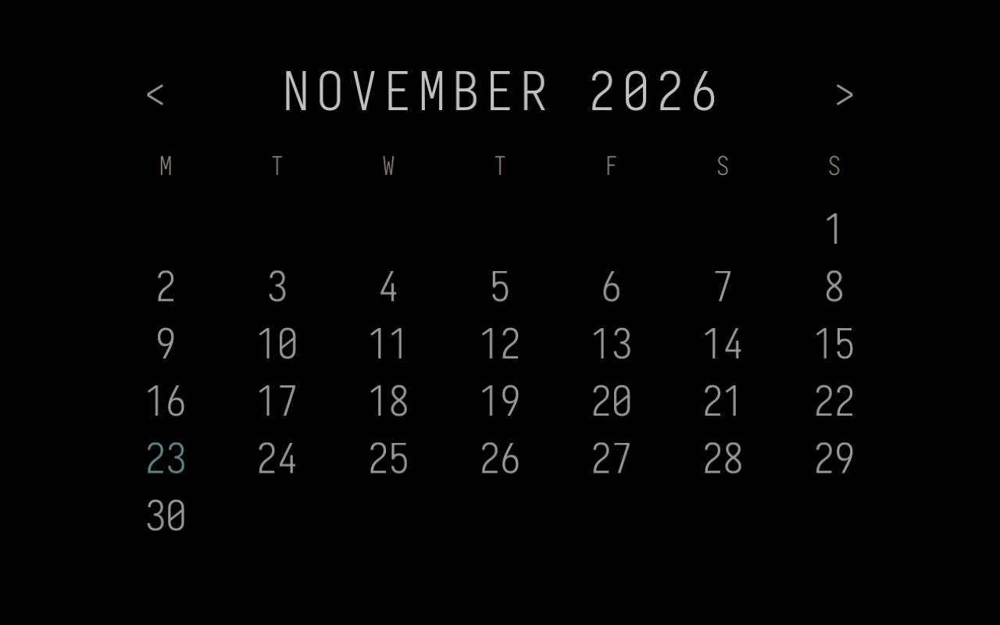

# clck

A minimalistic clock app.




## Build

```sh
scripts/setup-sdk.sh   # once: installs the Android SDK/NDK into .android-sdk
scripts/build-apk.sh   # build/clck.apk
```

Needs Rust, a JDK and ~7 GB for the SDK.

## Run

```sh
scripts/emulator.sh   # boot the tablet emulator
scripts/run.sh        # build, install, launch, screenshot
```

## Release

Pushing a `v*` tag publishes one signed APK per ABI. Signing uses a persistent
key stored in the `ANDROID_KEYSTORE_BASE64` and `ANDROID_KEYSTORE_PASSWORD`
repository secrets.

## Tests

```sh
cargo test --lib
```
